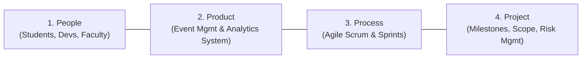

# PROJECT MANAGEMENT, ESTIMATION AND AGILE SPECIFICATION
## College Event Management and Participation Analysis System

---

**Course Code & Name:** 25ITT33 – Software Engineering  
**Department:** Information Technology  
**Institution:** Velalar College of Engineering and Technology, Erode – 12  
**Activity:** Project-Based Assessment (Scenario 1)  

---

## 1. The 4 P’s Management Framework

Effective project management coordinates four critical dimensions:

1. **People:**
   - **Stakeholders:** Academic Dean, Heads of Departments, Event Coordinators, Students.
   - **Team Roles:** Project Lead / Architect (Register No. 1), Backend Java Engineer (Reg No. 31), Database Administrator (Reg No. 61), Data Analyst / Python Specialist (Reg No. 91), QA & Documentation Specialist (Reg No. L1).
2. **Product:**
   - Unified college platform delivering event scheduling, automated duplicate-free registration, attendance capture, and Python-driven predictive analytics.
3. **Process:**
   - Hybrid Agile-Scrum methodology with 2-week sprint cycles, continuous code reviews, and iterative validation of deliverables.
4. **Project:**
   - Scope definition, deliverable tracking across the 4 subject curricula, risk management, and GitHub version control.

---

## 2. Software Project Estimation

### 2.1 Function Point (FP) Analysis
Function Points measure functionality delivered based on external inputs, outputs, inquiries, internal files, and external interfaces.

| Information Domain Value | Count | Weight (Simple/Avg) | FP Contribution |
|---|---|---|---|
| **External Inputs (EI)** (Event form, Student reg, Feedback, Attendance) | 4 | 4 | 16 |
| **External Outputs (EO)** (Event confirmation, Visual charts, Audit reports) | 3 | 5 | 15 |
| **External Inquiries (EQ)** (Browse events, Seat query, History query) | 3 | 4 | 12 |
| **Internal Logical Files (ILF)** (Events, Registrations, Students, Analytics) | 4 | 10 | 40 |
| **External Interface Files (EIF)** (Python bridge, CSV export/import) | 2 | 7 | 14 |
| **Total Unadjusted Function Points (UFP)** | - | - | **97** |

- Using standard Technical Complexity Factor (TCF) with $\sum F_i = 32$:
  $$\text{VAF} = 0.65 + (0.01 \times 32) = 0.97$$
  $$\text{Adjusted FP} = \text{UFP} \times \text{VAF} = 97 \times 0.97 = \mathbf{94.09\text{ FP}}$$

---

### 2.2 COCOMO (Constructive Cost Model) Estimation

Using the Basic COCOMO Organic Mode for academic software:
- Total Source Lines of Code ($\text{KLOC}$) estimated across Java, Python, and SQL scripts $\approx 3.2\text{ KLOC}$.
- **Coefficients for Organic Mode:**
  $$a_b = 2.4, \quad b_b = 1.05, \quad c_b = 2.5, \quad d_b = 0.38$$

#### Calculations:
1. **Effort ($E$):**
   $$E = a_b \times (\text{KLOC})^{b_b} = 2.4 \times (3.2)^{1.05} \approx 2.4 \times 3.39 = \mathbf{8.14\text{ Person-Months}}$$
2. **Development Time ($D$):**
   $$D = c_b \times (E)^{d_b} = 2.5 \times (8.14)^{0.38} \approx 2.5 \times 2.22 = \mathbf{5.55\text{ Months}}$$
3. **Average Staffing ($SS$):**
   $$SS = \frac{E}{D} = \frac{8.14}{5.55} \approx \mathbf{1.46 \approx 2\text{ Engineers}}$$

---

## 3. Risk Management & Mitigation (RMMM Plan)

| Risk ID | Risk Description | Category | Probability | Impact | Mitigation & Contingency Strategy |
|---|---|---|---|---|---|
| **R-01** | Concurrent duplicate registrations causing overbooking | Technical | High | High | Enforce database UNIQUE constraints (`student_id`, `event_id`) and Java synchronized transaction blocks. |
| **R-02** | Database connection failure between Java/Python | Technical | Low | High | Implement automatic fallback to local SQLite database and structured CSV caching. |
| **R-03** | Missing student feedback or biased ratings | User / Data | Medium | Low | Introduce mandatory 1-click rating upon downloading participation certificates. |
| **R-04** | Python dependency conflicts | Environmental | Medium | Medium | Include standardized `requirements.txt` and check installed packages prior to running scripts. |
| **R-05** | Scope creep within academic timeline | Project | Medium | Medium | Strict adherence to the 7 core functional requirements outlined in Scenario 1. |

---

## 4. Quality Standards & CMMI Alignment

The project aligns with **CMMI Level 3 (Defined)** practices:
- **Defined Processes:** Documented coding guidelines, Git branching strategy, and unified test case plans.
- **Verification:** Unit tests covering all validation methods with $>90\%$ code coverage.
- **Traceability:** Requirements Traceability Matrix linking functional requirements directly to source code and test outputs.
