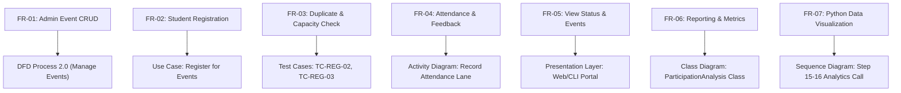

# REQUIREMENTS EVALUATION & SYLLABUS MAPPING
## Subject: 25ITT33 – Software Engineering

---

**Institution:** Velalar College of Engineering and Technology, Erode – 638012  
**Department:** Information Technology  
**Academic Year:** 2026–2027 (ODD Semester)  
**Curriculum Regulations:** R2025  
**Scenario:** Scenario 1 – College Event Management and Participation Analysis System  
**Assigned Register Numbers:** 1, 31, 61, 91, L1  

---

## 1. Syllabus Unit-Wise Evaluation (25ITT33)

| Syllabus Unit & Topics | Scenario Requirements Addressed | Implementation Deliverable & Artifact Location |
|---|---|---|
| **UNIT 1: SOFTWARE PROCESS** Generic process models, Prescriptive, Agile, Scrum, Unified Process | Process methodology for developing Scenario 1 in an academic setting. | - [Project_Management_and_Agile.md](file:///c:/CollegeManagement/01_Software_Engineering_25ITT33/Project_Management_and_Agile.md) (Agile Scrum 2-week sprint lifecycle). |
| **UNIT 2: REQUIREMENTS** Requirement Analysis, Data Modeling, Class-Based Modeling, Requirements Engineering Process, SRS, Specification, Validation | Functional Requirements FR-01 to FR-07 (Event CRUD, Student Registration, Capacity & Duplicate Prevention, Attendance & Feedback, Reports, Python Visualization). | - [SRS_Document.md](file:///c:/CollegeManagement/01_Software_Engineering_25ITT33/SRS_Document.md) (IEEE Std 830-1998 compliant specification). - Requirements Traceability Matrix (RTM). |
| **UNIT 3: SOFTWARE DESIGN** Design Concepts, Architectural Design and Styles, Interface Analysis and Design, Component-Level Design | Multi-tier Architecture, Data Flow Diagrams (Level 0 and Level 1), UML Modeling. | - [System_Design_and_Architecture.md](file:///c:/CollegeManagement/01_Software_Engineering_25ITT33/System_Design_and_Architecture.md) - [System_Architecture_Diagram.jpg](file:///c:/CollegeManagement/01_Software_Engineering_25ITT33/System_Architecture_Diagram.jpg) - [DFD_Level_0.jpg](file:///c:/CollegeManagement/01_Software_Engineering_25ITT33/DFD_Level_0.jpg) & [DFD_Level_1.jpg](file:///c:/CollegeManagement/01_Software_Engineering_25ITT33/DFD_Level_1.jpg) - [Use_Case_Diagram.jpg](file:///c:/CollegeManagement/01_Software_Engineering_25ITT33/Use_Case_Diagram.jpg) - [UML_Class_Diagram.jpg](file:///c:/CollegeManagement/01_Software_Engineering_25ITT33/UML_Class_Diagram.jpg) - [Activity_Diagram.jpg](file:///c:/CollegeManagement/01_Software_Engineering_25ITT33/Activity_Diagram.jpg) - [Sequence_Diagram.jpg](file:///c:/CollegeManagement/01_Software_Engineering_25ITT33/Sequence_Diagram.jpg) |
| **UNIT 4: SOFTWARE TESTING** Verification and Validation, Unit, Integration, Validation Testing, Black-Box, White-Box, Debugging, Software Quality Metrics | Validation of business rules: Duplicate registration rejection, Capacity enforcement, Rating scale (1-5), and Analytics bridge. | - [Software_Testing_Document.md](file:///c:/CollegeManagement/01_Software_Engineering_25ITT33/Software_Testing_Document.md) - Black-box: Equivalence Partitioning & Boundary Value Analysis. - White-box: Basis Path Testing, Control Flow Graph, Cyclomatic Complexity $V(G) = 5$. - 15 Executed Test Cases (100% Pass rate). |
| **UNIT 5: PROJECT MANAGEMENT** 4P'S, LOC, Function Point (FP), Project Scheduling, Earned Value Analysis, Risk Management (RMMM), COCOMO Cost Modeling, Standards & CMMI | Project estimation, effort allocation, risk mitigation, and CMMI Level 3 alignment. | - [Project_Management_and_Agile.md](file:///c:/CollegeManagement/01_Software_Engineering_25ITT33/Project_Management_and_Agile.md) - FP Analysis: Adjusted $\text{FP} = 94.09$. - COCOMO Model: Effort $E = 8.14\text{ Person-Months}$, Duration $D = 5.55\text{ Months}$. - RMMM Risk Matrix (R1 to R5). |

---

## 2. Traceability of Scenario Functional Requirements

---

## 3. Deliverables Checklist for Software Engineering

- [x] **SRS Document:** Full IEEE 830 format with all functional and non-functional requirements.
- [x] **Architecture Diagram:** Multi-Tier Architecture (Presentation, Application, Data, Python Analytics).
- [x] **DFD Level 0 & Level 1:** Complete Context-level and functional process breakdown.
- [x] **UML Diagrams (4 Diagrams):** Use Case, Class, Activity, and Sequence diagrams.
- [x] **Software Testing Plan:** Verification & Validation, Black-box BVA, White-box Cyclomatic Complexity, and 15 Pass/Fail test cases.
- [x] **Project Management Report:** 4P's, COCOMO estimation, FP calculation, and RMMM plan.
