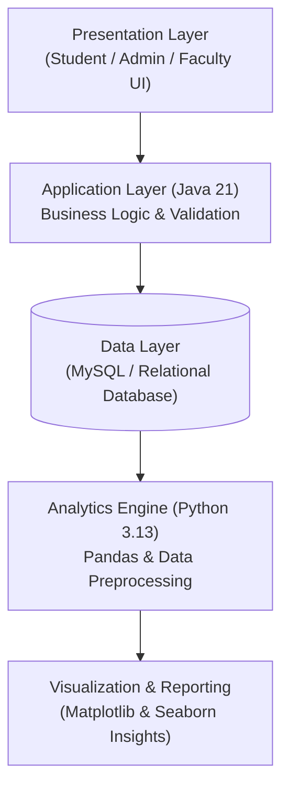

# SOFTWARE REQUIREMENTS SPECIFICATION (SRS)
## College Event Management and Participation Analysis System

---

**Institution:** Velalar College of Engineering and Technology, Erode – 638012  
**Department:** Information Technology  
**Academic Year:** 2026–2027 (ODD Semester)  
**Course Code & Name:** 25ITT33 – Software Engineering  
**Activity:** Project-Based Assessment  
**Scenario:** Scenario 1 – College Event Management and Participation Analysis System  
**Target Register Numbers:** 1, 31, 61, 91, L1  
**Standard:** IEEE Std 830-1998 Compliant Specification  

---

## 1. Introduction

### 1.1 Purpose
The purpose of this Software Requirements Specification (SRS) document is to provide a complete, detailed, and formal description of the **College Event Management and Participation Analysis System**. It defines the functional, behavioral, non-functional, and interface requirements for the system, serving as the contractual baseline between stakeholders (College Administration, Faculty Organizers, and Students) and the development team.

### 1.2 Scope
Velalar College of Engineering and Technology regularly organizes a wide array of co-curricular and extracurricular events including technical symposiums, national seminars, hands-on workshops, and cultural fests. The current manual process involves paper-based registrations, physical attendance sheets, and unstructured feedback collection, which introduces high rates of human error, duplicate registrations, capacity breaches, and an inability to track student engagement over time.

The **College Event Management and Participation Analysis System** automates the entire event lifecycle:
- Centralized event creation, scheduling, and quota management by administrators.
- Online student registrations with real-time duplicate checks and capacity validation.
- Digital attendance tracking and structured student feedback collection.
- Automated report generation for faculty and department heads.
- Integrated Python-powered data analytics pipeline to preprocess engagement data, identify participation trends, and render publication-quality visual insights.

### 1.3 Definitions, Acronyms, and Abbreviations
- **SRS:** Software Requirements Specification
- **DFD:** Data Flow Diagram
- **ERD:** Entity-Relationship Diagram
- **UML:** Unified Modeling Language
- **GUI:** Graphical User Interface / Web Interface
- **CLI:** Command-Line Interface
- **CRUD:** Create, Read, Update, Delete
- **ACID:** Atomicity, Consistency, Isolation, Durability
- **VCET:** Velalar College of Engineering and Technology
- **EDA:** Exploratory Data Analysis
- **CSV:** Comma Separated Values

### 1.4 References
1. IEEE Std 830-1998: *IEEE Recommended Practice for Software Requirements Specifications*.
2. Roger S. Pressman & Bruce R. Maxim, *Software Engineering: A Practitioner’s Approach*, 9th Edition, McGraw-Hill, 2020.
3. Ian Sommerville, *Software Engineering*, 10th Edition, Pearson, 2023.
4. VCET Curriculum & Syllabi for B.Tech Information Technology (Regulations 2025).

### 1.5 Overview of Document
The remainder of this document outlines the overall product perspective, user personas, operational constraints, detailed functional requirements mapped directly to Scenario 1, external interface specifications, and non-functional quality attributes.

---

## 2. Overall Description

### 2.1 Product Perspective
The system is an autonomous multi-tier academic management and analytical platform comprising:
1. **Presentation Layer:** Web and console-based user interface for Students, Administrators, and Faculty.
2. **Application (Business Logic) Layer:** Implemented in Java 21, enforcing strict business rules (duplicate prevention, capacity limits, eligibility validation).
3. **Data Layer:** Relational Database (MySQL / SQLite) storing normalized event, student, registration, attendance, and feedback records.
4. **Analytics Layer:** Dedicated Python 3.13 engine utilizing NumPy, Pandas, Matplotlib, and Seaborn for data retrieval, preprocessing, statistical summarization, and data visualization.

### 2.2 User Classes and Characteristics
| User Persona | Responsibilities & Privilege Level | Technical Proficiency |
|---|---|---|
| **Administrator / Organizer** | Creates, updates, reschedules, and cancels events; sets participant caps; oversees venue allocation; monitors real-time registrations; triggers analytical reports. | Medium |
| **Student** | Browses upcoming symposiums, workshops, and seminars; registers with student credentials; views confirmed registration status; submits post-event ratings and feedback. | Basic |
| **Faculty / Department Head** | Reviews participation statistics, analyzes student engagement across academic departments, downloads compliance summaries and accreditation reports. | Medium |
| **System Daemon / Batch Engine** | Automatically processes waitlists, updates participation scores, exports analytics batches for Python processing. | Automated |

### 2.3 Operating Environment
- **Server OS:** Cross-platform (Windows 11 / Linux Ubuntu 22.04 LTS / macOS).
- **Runtime Environment:** Java Development Kit (JDK 21 LTS) & Python 3.13+.
- **Database Engine:** MySQL 8.0+ / SQLite 3.40+.
- **Hardware Minimums:** 4-Core CPU, 8 GB RAM, 10 GB Storage.

### 2.4 Design and Implementation Constraints
1. **Concurrency Constraint:** The system must prevent overbooking when multiple concurrent student registration requests hit the database simultaneously.
2. **Data Integrity:** Referential integrity must be strictly enforced via Foreign Keys with appropriate `CASCADE` and `RESTRICT` rules.
3. **Interoperability:** Seamless data exchange between the Java transactional core and Python analytics engine via database queries and standard structured datasets (CSV/JSON).
4. **Language & Tools:** Adherence to standard Java OOP principles and PEP 8 Python coding standards.

### 2.5 Assumptions and Dependencies
- Each student is uniquely identified by an institutional Register Number (e.g., `25IT001`, `25IT031`, `25IT061`, `25IT091`, `25ITL01`).
- Events have a pre-allocated seating capacity and registration cutoff timestamp.
- Python runtime has data science libraries (`pandas`, `matplotlib`, `seaborn`, `numpy`) pre-installed.

---

## 3. Specific Requirements & Functional Specifications

The following functional requirements directly fulfill the mandated assignment criteria:

### FR-01: Event Management (Administrator)
- **Description:** The system shall allow administrators to create new events, update existing event metadata, view all events, and safely delete/cancel events.
- **Inputs:** Event ID, Title, Category (Symposium, Workshop, Seminar, Cultural), Description, Date/Time, Venue, Maximum Capacity.
- **Processing:** Validate that event date is in the future, venue is not double-booked, and capacity is greater than zero.
- **Output:** Event successfully stored in database with status `ACTIVE`.

### FR-02: Student Registration
- **Description:** Students shall be able to register for active events by providing their student credentials.
- **Inputs:** Student Register Number, Event ID.
- **Processing:** Validate student eligibility, verify that the event status is `ACTIVE`.
- **Output:** Unique Registration ID, status set to `CONFIRMED`, and registered count incremented.

### FR-03: Duplicate & Capacity Prevention
- **Description:** The system must strictly reject duplicate registrations and reject registrations exceeding the pre-set capacity.
- **Processing Rules:**
  1. If `COUNT(Registration WHERE student_id = X AND event_id = Y) > 0`, throw `DuplicateRegistrationException`.
  2. If `registered_count >= event_capacity`, throw `CapacityExceededException` and notify the student that the event is full.
- **Output:** Meaningful error message returned to user; database state rolled back.

### FR-04: Attendance & Feedback Recording
- **Description:** The system shall record student physical/virtual attendance and enable post-event feedback submission.
- **Inputs:** Attendance status (`ATTENDED`, `ABSENT`), Feedback Rating (integer 1 to 5), Qualitative Comments.
- **Processing:** Ensure only registered students who attended the event can submit ratings and comments. Validate rating scale ($1 \le \text{rating} \le 5$).
- **Output:** Attendance timestamp saved; feedback entry logged and linked to event analytics.

### FR-05: Event Details and Registration Status Inquiries
- **Description:** Students and organizers shall be able to view real-time event details, seat availability, and personalized registration history.
- **Outputs:** Filtered lists by department, category, and date; personalized dashboard displaying registration confirmation badges.

### FR-06: Participation & Student Engagement Reporting
- **Description:** The system shall compute overall attendance rates, department-wise participation ratios, and student engagement indexes.
- **Formulae:**
  $$\text{Attendance Rate (\%)} = \left(\frac{\text{Total Attended Students}}{\text{Total Registered Students}}\right) \times 100$$
  $$\text{Capacity Utilization (\%)} = \left(\frac{\text{Total Registered Students}}{\text{Event Capacity}}\right) \times 100$$
- **Output:** Formatted tabular reports and structured CSV data exports.

### FR-07: Python Data Retrieval, Preprocessing & Visualization
- **Description:** Python analytics layer shall extract data from the database, perform cleaning/normalization, and generate graphical visualizations.
- **Processing Steps:**
  1. Retrieve event, participant, and feedback tables.
  2. Handle null values, remove anomalies, and calculate Z-scores.
  3. Generate Bar Charts, Line Charts, Donut Charts, Histograms, Box Plots, and Heatmaps.
- **Output:** High-resolution charts saved to the `visualizations/` directory.

---

## 4. External Interface Requirements

### 4.1 User Interfaces
- **Console / Terminal UI:** Text-driven interactive menu system with formatted ASCII tables, clear error feedback, and guided input validation.
- **Web UI Specification:** Responsive layouts providing dedicated dashboards for Student, Admin, and Faculty roles with intuitive event cards and modal forms.

### 4.2 Software Interfaces
- **Operating System:** Windows 10/11, Linux, macOS.
- **Java Virtual Machine:** OpenJDK 21 (Temurin).
- **Database Driver:** JDBC Type 4 MySQL Connector / SQLite JDBC.
- **Python Environment:** Python 3.13 with `pandas`, `numpy`, `matplotlib`, `seaborn`, `mysql-connector-python`.

### 4.3 Hardware Interfaces
- Standard x86_64 / ARM64 workstation with minimum 1024x768 display resolution for viewing graphical charts.

---

## 5. Non-Functional Requirements (NFRs)

### 5.1 Performance Requirements
- **NFR-P1 (Response Time):** Transactional queries (login, registration) must execute in under $200\text{ ms}$ under normal load.
- **NFR-P2 (Throughput):** System must support up to 500 concurrent registration requests without deadlocks.
- **NFR-P3 (Analytics Batch Time):** Python visualization script must complete end-to-end execution and render 8 charts in under $5\text{ seconds}$.

### 5.2 Reliability & Availability
- **NFR-R1 (Availability):** 99.5% uptime during active college semester periods.
- **NFR-R2 (Fault Tolerance):** All database operations must be wrapped in ACID transactions. Failure during registration must automatically roll back changes.

### 5.3 Security Requirements
- **NFR-S1 (Authentication):** Role-based access control (Admin, Student, Faculty).
- **NFR-S2 (SQL Injection Prevention):** Strict usage of JDBC `PreparedStatement` and parameterized queries in both Java and Python.
- **NFR-S3 (Audit Logging):** System logs timestamp, user ID, and action for every registration, cancellation, and event modification.

### 5.4 Maintainability & Portability
- **NFR-M1 (Modularity):** Clean separation of concerns following DAO and MVC design patterns.
- **NFR-M2 (Platform Independence):** Java bytecode runs uniformly across all platforms; Python scripts utilize OS-agnostic path handling (`os.path` / `pathlib`).

---

## 6. Requirements Traceability Matrix (RTM)

| Req ID | Requirement Description | Design Module | Java Class | Database Table | Test Case ID |
|---|---|---|---|---|---|
| **FR-01** | Admin Event Management | `EventDAO` | `Event.java`, `OrganizerAdmin.java` | `events`, `categories` | `TC-EVT-01`, `TC-EVT-02` |
| **FR-02** | Student Registration | `RegistrationService` | `Student.java`, `Registration.java` | `registrations` | `TC-REG-01` |
| **FR-03** | Capacity & Duplicate Check | `RegistrationService` | `EventService.java` | `registrations`, `events` | `TC-REG-02`, `TC-REG-03` |
| **FR-04** | Attendance & Feedback | `FeedbackDAO` | `Feedback.java` | `attendance`, `feedback` | `TC-FDB-01`, `TC-FDB-02` |
| **FR-05** | View Events & Status | `EventDAO` | `Event.java`, `Student.java` | `events`, `v_event_summary` | `TC-INQ-01` |
| **FR-06** | Reporting & Metrics | `AnalyticsService` | `ParticipationAnalysis.java` | `analytics_summary` | `TC-REP-01` |
| **FR-07** | Python Visualization | `eda_and_visualization.py` | Python Engine | SQLite / MySQL Views | `TC-PY-01`, `TC-PY-02` |
