# SYSTEM DESIGN AND ARCHITECTURAL SPECIFICATION
## College Event Management and Participation Analysis System

---

**Course Code & Name:** 25ITT33 – Software Engineering  
**Department:** Information Technology  
**Institution:** Velalar College of Engineering and Technology, Erode – 12  
**Activity:** Project-Based Assessment (Scenario 1)  

---

## 1. Executive Summary

This document details the architectural, functional, and object-oriented design for the **College Event Management and Participation Analysis System**. The design bridges user requirements with physical implementation, employing structured analysis models (Data Flow Diagrams) and Object-Oriented Modeling (Unified Modeling Language - UML).

---

## 2. Overall System Architecture

The system follows a modern **Multi-Tier Layered Architecture** augmented with an asynchronous **Python Analytics Subsystem**. This decouples high-throughput Online Transaction Processing (OLTP) in the Java backend from compute-intensive Online Analytical Processing (OLAP) in Python.

### Architectural Blueprint
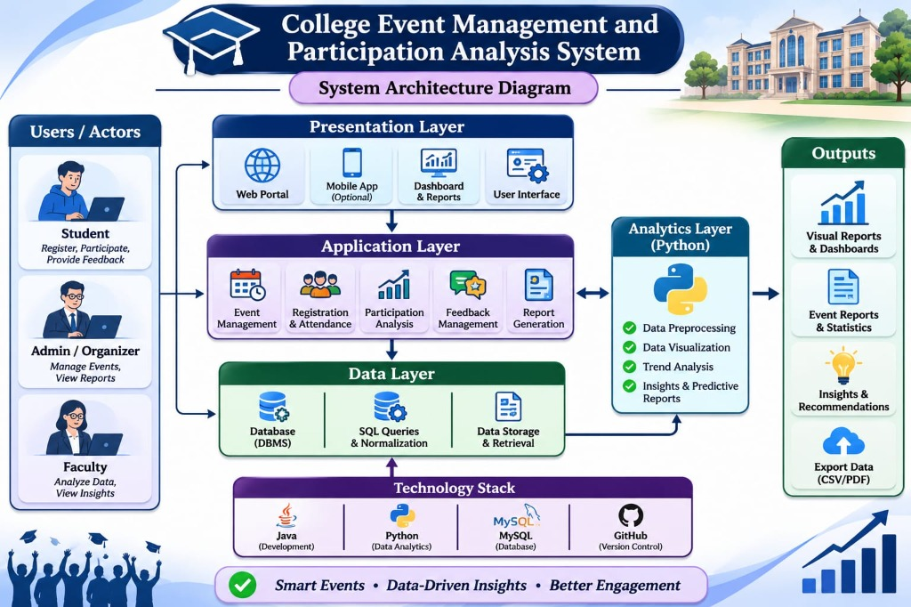

### Layer Descriptions

1. **Presentation Layer:**
   - Provides user interfaces for **Students**, **Administrators/Organizers**, and **Faculty**.
   - Includes Web Portal, CLI dashboards, and reporting views.
   - Handles input presentation, form validation, and renders data visualization charts.

2. **Application (Business Logic) Layer:**
   - Implemented in **Java 21**.
   - Contains core services: `Event Management`, `Registration & Attendance`, `Participation Analysis`, `Feedback Management`, and `Report Generation`.
   - Enforces business rules: prevents duplicate registrations, enforces capacity thresholds, and handles concurrency locks.

3. **Data Layer:**
   - Implemented in **MySQL / SQLite Relational Database Management System**.
   - Handles structured data persistence, normalization (3NF/BCNF), relational constraints, and query execution.
   - Maintains transactional consistency through ACID properties.

4. **Analytics Layer (Python 3.13):**
   - Connects to the database to extract operational event and participant datasets.
   - Performs data preprocessing, cleaning, outlier detection, and feature engineering with **NumPy** and **Pandas**.
   - Generates visual analytics, trends, and correlation charts using **Matplotlib** and **Seaborn**.
   - Outputs reports, statistics, predictive insights, and exportable data (CSV/PDF).

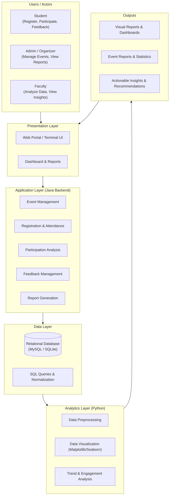

---

## 3. Data Flow Diagrams (DFD)

Data Flow Modeling traces the transformation of data through the system from source to sink.

### 3.1 Level 0 DFD (Context Level)
The Context Diagram establishes the boundary of the system, external entities, and high-level input/output data flows.

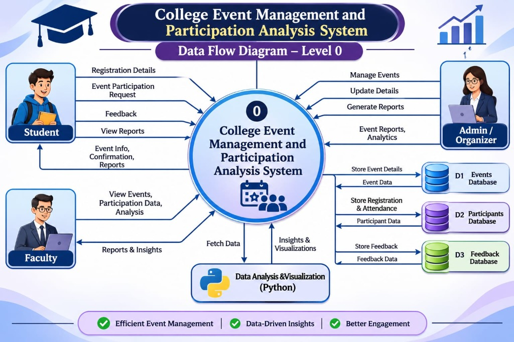

#### External Entities & Flow Description:
1. **Student:**
   - **Inputs to System:** Registration Details, Event Participation Request, Feedback.
   - **Outputs from System:** Event Info, Confirmation, Attendance Status, Reports.
2. **Admin / Organizer:**
   - **Inputs to System:** Manage Events (Add/Update/Delete), Event Details, Reports Request.
   - **Outputs from System:** Event Reports, Participation Analytics, Attendance Logs.
3. **Faculty:**
   - **Inputs to System:** View Events Request, Participation Data Query, Analysis Request.
   - **Outputs from System:** Departmental Reports, Student Engagement Insights.
4. **Data Analysis & Visualization (Python Subsystem):**
   - Receives raw transactional data from database.
   - Transmits processed charts, descriptive metrics, and insights back to system.
5. **Data Stores:**
   - **D1 Events Database:** Stores scheduled events, dates, venues, categories, capacities.
   - **D2 Participants Database:** Stores student profiles, registrations, and attendance logs.
   - **D3 Feedback Database:** Stores ratings, reviews, and qualitative feedback.

---

### 3.2 Level 1 DFD (Detailed Functional Decomposition)
Decomposes the core system into 5 primary operational sub-processes.

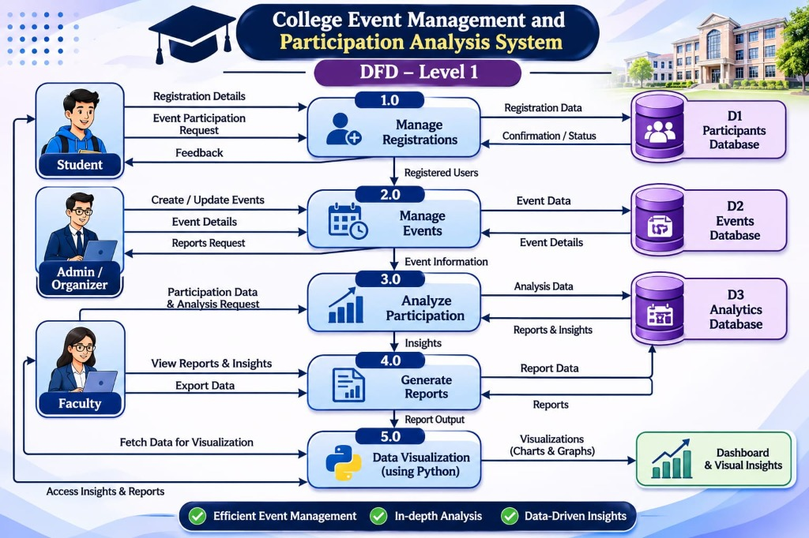

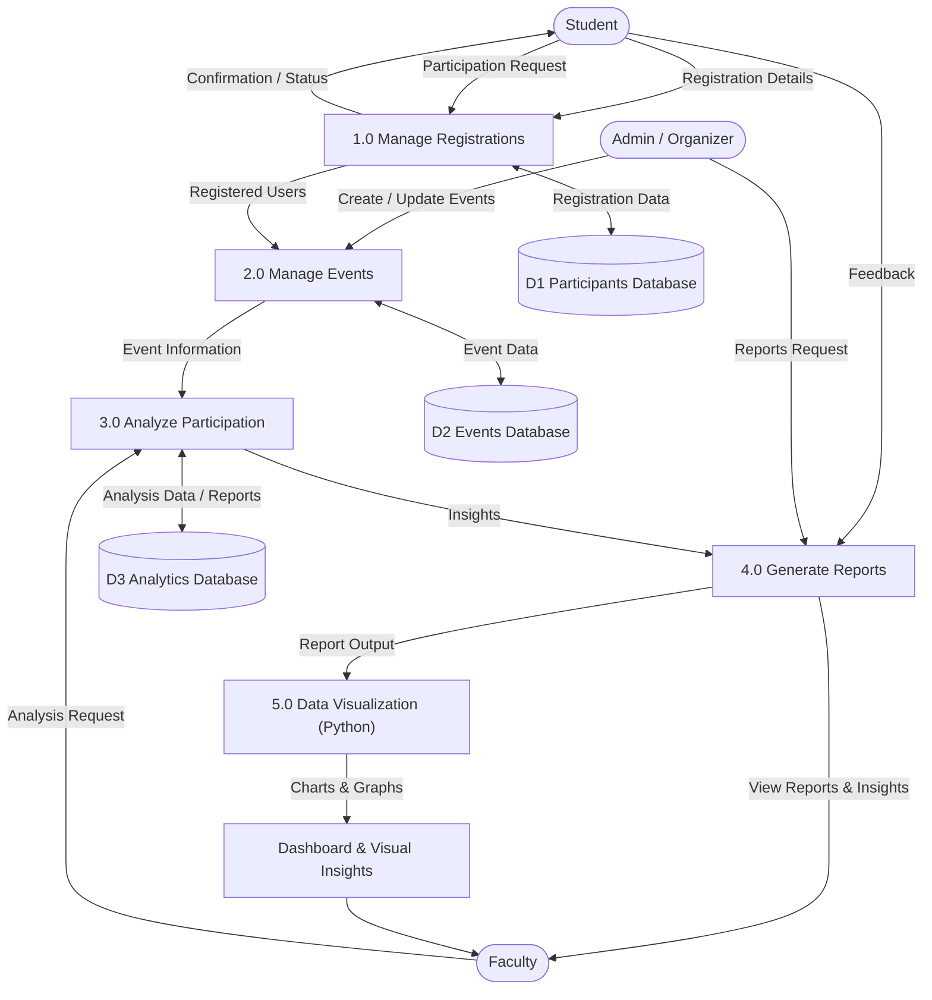

#### Detailed Process Descriptions:
- **Process 1.0 (Manage Registrations):** Validates incoming student requests, cross-references event capacity from D2, checks for duplicate records in D1, and issues confirmation.
- **Process 2.0 (Manage Events):** Admin registers new symposiums/workshops, edits date/venue, or archives concluded events in D2.
- **Process 3.0 (Analyze Participation):** Pulls attendance logs from D1 and event schedules from D2 to calculate attendance ratios and department engagement.
- **Process 4.0 (Generate Reports):** Synthesizes feedback ratings from D3 with participation logs to compile audit reports.
- **Process 5.0 (Data Visualization using Python):** Preprocesses raw metrics into visual plots (Bar, Pie, Heatmap, Box plots) for display on the interactive dashboard.

---

## 4. Unified Modeling Language (UML) Diagrams

### 4.1 UML Use Case Diagram
Specifies system functionality from the perspective of external actors.

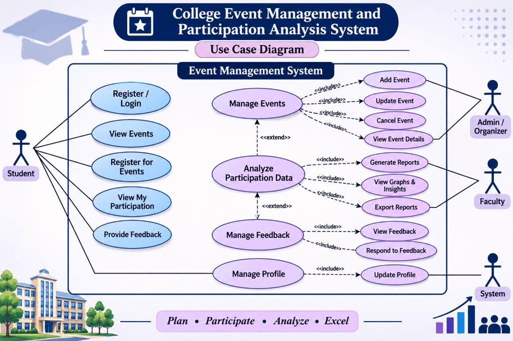

#### Actors & Use Cases:
- **Student:**
  - `Register / Login`
  - `View Events`
  - `Register for Events`
  - `View My Participation`
  - `Provide Feedback`
- **Admin / Organizer:**
  - `Manage Events` (includes `Add Event`, `Update Event`, `Cancel Event`, `View Event Details`)
  - `Analyze Participation Data` (includes `Generate Reports`, `View Graphs & Insights`, `Export Reports`)
- **Faculty:**
  - `Analyze Participation Data`
  - `Manage Feedback` (includes `View Feedback`, `Respond to Feedback`)
- **System:**
  - `Manage Profile` (includes `Update Profile`)

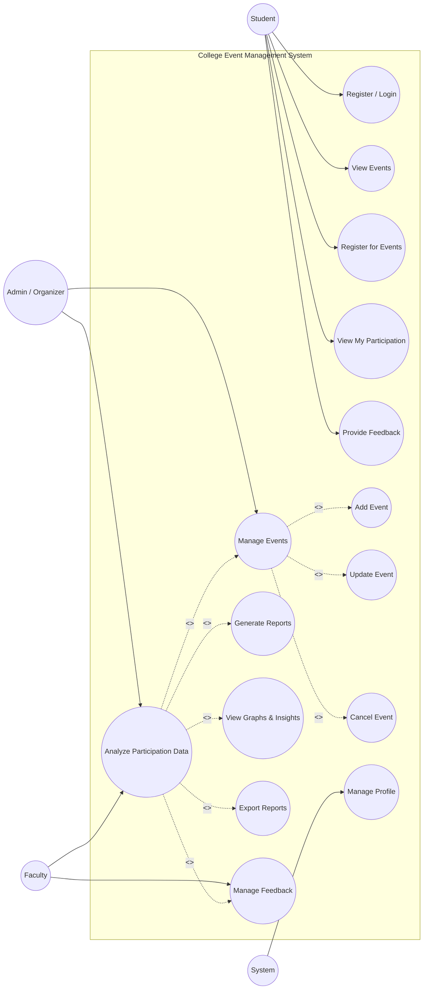

---

### 4.2 UML Class Diagram
Represents the static structure of the object-oriented Java system.

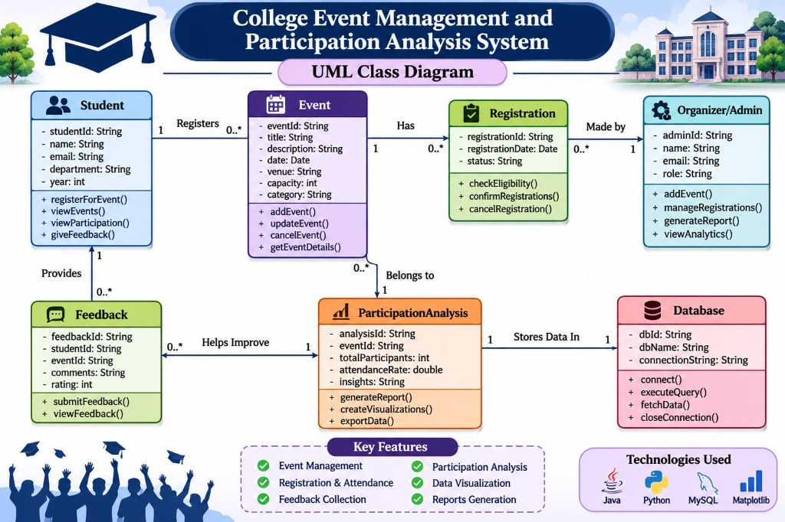

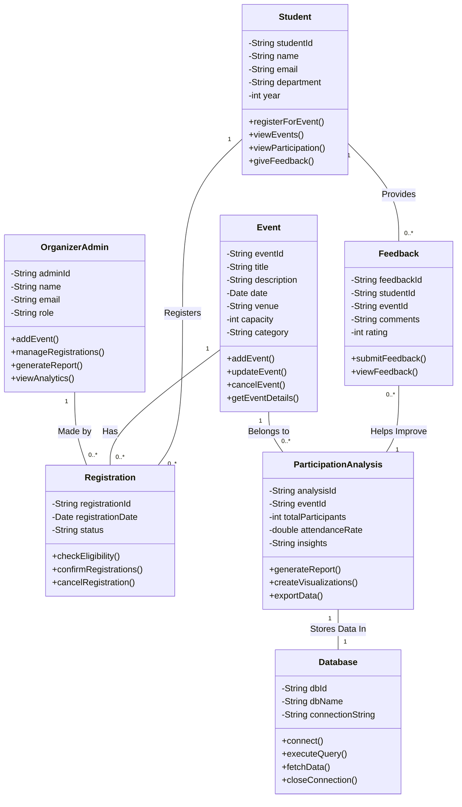

---

### 4.3 UML Activity Diagram
Details the end-to-end dynamic operational workflow across actors and swimlanes.

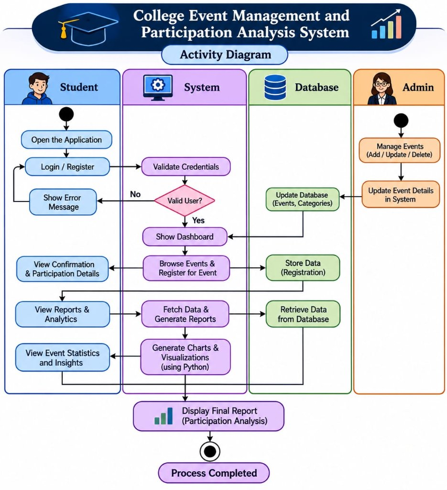

- **Student Lane:** Starts application $\rightarrow$ Login/Register $\rightarrow$ Browse events $\rightarrow$ Confirm participation $\rightarrow$ View reports.
- **System Lane:** Validates credentials $\rightarrow$ Verifies seat availability $\rightarrow$ Dispatches confirmation $\rightarrow$ Calls Python analytics script.
- **Database Lane:** Updates events, stores registrations, persists feedback ratings, and yields query results.
- **Admin Lane:** Initializes events, modifies dates/venues, adjusts quotas.

---

### 4.4 UML Sequence Diagram
Models object interaction and chronological message passing during event registration and analytical reporting.

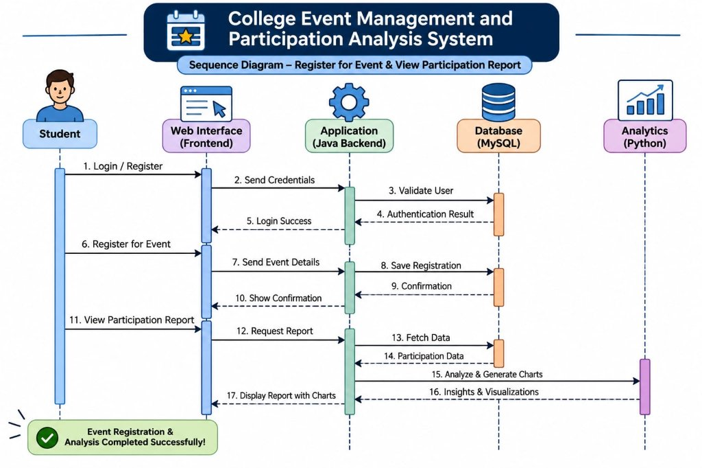

1. `Student` sends credentials to `Web Interface (Frontend)`.
2. Frontend delegates to `Application (Java Backend)`.
3. Backend validates against `Database (MySQL)`.
4. Student selects an event and requests registration.
5. Backend verifies capacity, checks duplicate entries, and saves record to Database.
6. Confirmation acknowledgment returns to Student.
7. Student/Faculty requests participation report.
8. Backend queries Database for attendance and scores.
9. Backend invokes `Analytics (Python)` subsystem to preprocess data and render charts.
10. Final report with charts and engagement metrics is displayed on Frontend.
