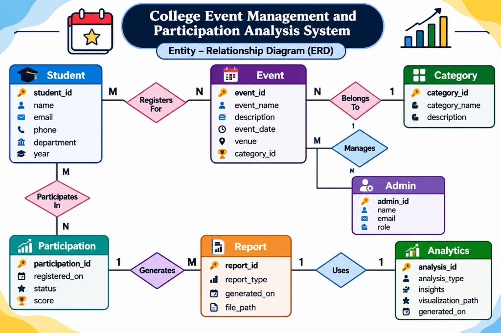
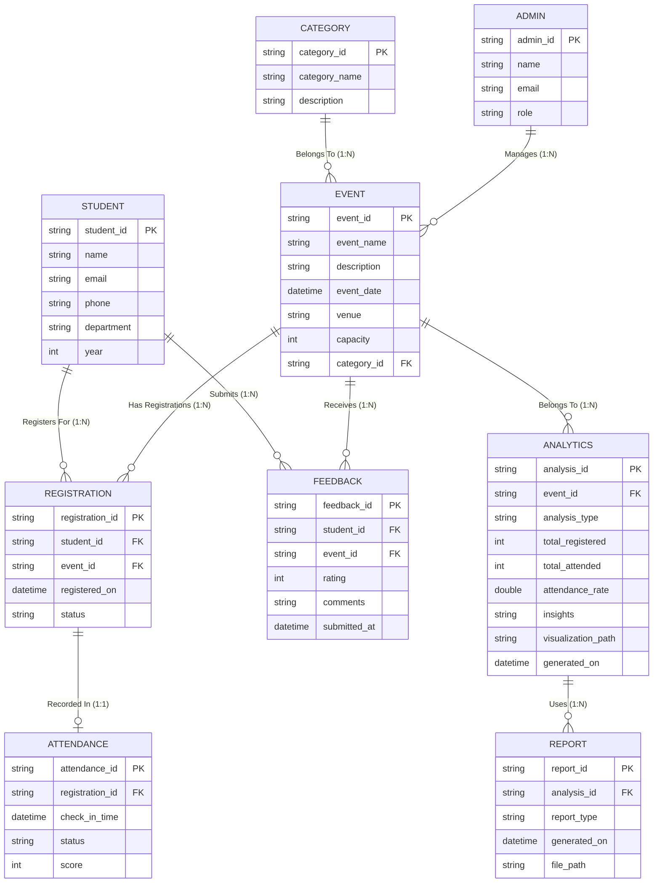

# ENTITY-RELATIONSHIP AND RELATIONAL MODEL SPECIFICATION
## College Event Management and Participation Analysis System

---

**Course Code & Name:** 25ITT31 – Database Management Systems  
**Department:** Information Technology  
**Institution:** Velalar College of Engineering and Technology, Erode – 12  
**Activity:** Project-Based Assessment (Scenario 1)  

---

## 1. Entity-Relationship (ER) Model

The Entity-Relationship model conceptualizes the operational data elements and associations within the College Event Management System.

### ER Diagram Blueprint

---

## 2. Entities, Attributes and Cardinalities

### 2.1 Entity Set Definitions
1. **Student:** Strong entity representing enrolled college students.
   - Primary Key: `student_id`
   - Attributes: `name`, `email`, `phone`, `department`, `year`.
2. **Event:** Strong entity representing symposiums, workshops, and seminars.
   - Primary Key: `event_id`
   - Attributes: `event_name`, `description`, `event_date`, `venue`, `capacity`, `category_id` (FK).
3. **Category:** Strong entity grouping events into academic categories.
   - Primary Key: `category_id`
   - Attributes: `category_name`, `description`.
4. **Admin / Organizer:** Strong entity representing faculty or staff coordinators.
   - Primary Key: `admin_id`
   - Attributes: `name`, `email`, `role`.
5. **Registration:** Associative entity establishing the Many-to-Many ($M:N$) mapping between `Student` and `Event`.
   - Primary Key: `registration_id`
   - Foreign Keys: `student_id`, `event_id`
   - Attributes: `registered_on`, `status` (`CONFIRMED`, `WAITLISTED`, `CANCELLED`).
6. **Attendance (Participation):** Captures physical presence of registered students.
   - Primary Key: `attendance_id`
   - Foreign Key: `registration_id`
   - Attributes: `check_in_time`, `status` (`ATTENDED`, `ABSENT`), `score`.
7. **Feedback:** Represents evaluations submitted by attendees.
   - Primary Key: `feedback_id`
   - Foreign Keys: `student_id`, `event_id`
   - Attributes: `rating` ($1 \le \text{rating} \le 5$), `comments`, `submitted_at`.
8. **Analytics & Report:** Stores computed aggregate insights, attendance rates, and visualization chart paths.
   - Primary Keys: `analysis_id`, `report_id`.

---

## 3. Relational Schema Mapping

Converting ER entities to relational tables with referential integrity constraints:

1. **`categories`** (
   $\underline{\text{category\_id}}$, $\text{category\_name}$, $\text{description}$
)
2. **`admins`** (
   $\underline{\text{admin\_id}}$, $\text{name}$, $\text{email}$, $\text{role}$
)
3. **`students`** (
   $\underline{\text{student\_id}}$, $\text{name}$, $\text{email}$, $\text{phone}$, $\text{department}$, $\text{year}$
)
4. **`events`** (
   $\underline{\text{event\_id}}$, $\text{event\_name}$, $\text{description}$, $\text{event\_date}$, $\text{venue}$, $\text{capacity}$, $\text{category\_id}^*$, $\text{created\_by}^*$
)  
   - $\text{category\_id}$ references `categories(category_id)`
   - $\text{created\_by}$ references `admins(admin_id)`
5. **`registrations`** (
   $\underline{\text{registration\_id}}$, $\text{student\_id}^*$, $\text{event\_id}^*$, $\text{registered\_on}$, $\text{status}$
)  
   - $\text{student\_id}$ references `students(student_id)`
   - $\text{event\_id}$ references `events(event_id)`
   - **Composite Alternate Key / Unique Constraint:** $\text{UNIQUE}(\text{student\_id}, \text{event\_id})$ [Enforces FR-03: Duplicate prevention]
6. **`attendance`** (
   $\underline{\text{attendance\_id}}$, $\text{registration\_id}^*$, $\text{check\_in\_time}$, $\text{status}$, $\text{score}$
)  
   - $\text{registration\_id}$ references `registrations(registration_id)`
7. **`feedback`** (
   $\underline{\text{feedback\_id}}$, $\text{student\_id}^*$, $\text{event\_id}^*$, $\text{rating}$, $\text{comments}$, $\text{submitted\_at}$
)  
   - $\text{student\_id}$ references `students(student_id)`
   - $\text{event\_id}$ references `events(event_id)`
8. **`analytics`** (
   $\underline{\text{analysis\_id}}$, $\text{event\_id}^*$, $\text{analysis\_type}$, $\text{total\_registered}$, $\text{total\_attended}$, $\text{attendance\_rate}$, $\text{insights}$, $\text{visualization\_path}$, $\text{generated\_on}$
)  
   - $\text{event\_id}$ references `events(event_id)`
9. **`reports`** (
   $\underline{\text{report\_id}}$, $\text{analysis\_id}^*$, $\text{report\_type}$, $\text{generated\_on}$, $\text{file\_path}$
)  
   - $\text{analysis\_id}$ references `analytics(analysis_id)`

---

## 4. Formal Relational Algebra Operations

The following relational algebra expressions formalize essential system queries:

### 4.1 Selection ($\sigma$) & Projection ($\pi$)
Retrieve names and emails of all students in the 'Information Technology' department:
$$Q_1 = \pi_{\text{name, email}} \left( \sigma_{\text{department} = \text{'IT'}} (\text{STUDENT}) \right)$$

### 4.2 Natural Join ($\bowtie$)
Retrieve event names along with their respective category descriptions:
$$Q_2 = \pi_{\text{event\_name, category\_name, venue}} \left( \text{EVENT} \bowtie_{\text{EVENT.category\_id} = \text{CATEGORY.category\_id}} \text{CATEGORY} \right)$$

### 4.3 Theta Join with Aggregation
Retrieve student names who registered for the event with ID `'EVT-01'`:
$$Q_3 = \pi_{\text{STUDENT.name, REGISTRATION.registered\_on}} \left( \sigma_{\text{event\_id} = \text{'EVT-01'}} (\text{REGISTRATION}) \bowtie \text{STUDENT} \right)$$

### 4.4 Set Difference ($-$)
Identify registered students who did not attend the event (Absentee list):
$$Q_4 = \pi_{\text{registration\_id}} (\text{REGISTRATION}) - \pi_{\text{registration\_id}} \left( \sigma_{\text{status} = \text{'ATTENDED'}} (\text{ATTENDANCE}) \right)$$

### 4.5 Division Operation ($\div$)
Find students who have registered for **all** events in the 'Workshop' category:
$$Q_5 = \pi_{\text{student\_id, event\_id}} (\text{REGISTRATION}) \div \pi_{\text{event\_id}} \left( \sigma_{\text{category\_name} = \text{'Workshop'}} (\text{EVENT} \bowtie \text{CATEGORY}) \right)$$
