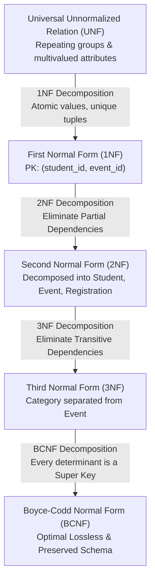

# DATABASE NORMALIZATION SPECIFICATION & MATHEMATICAL PROOFS
## College Event Management and Participation Analysis System

---

**Course Code & Name:** 25ITT31 – Database Management Systems  
**Department:** Information Technology  
**Institution:** Velalar College of Engineering and Technology, Erode – 12  
**Activity:** Project-Based Assessment (Scenario 1)  

---

## 1. Functional Dependency Theory & Armstrong’s Axioms

A **Functional Dependency (FD)** denoted by $X \rightarrow Y$ states that attribute set $X$ uniquely determines the values of attribute set $Y$ in relation $R$.

### Armstrong's Axioms:
1. **Axiom of Reflexivity:** If $Y \subseteq X$, then $X \rightarrow Y$.
2. **Axiom of Augmentation:** If $X \rightarrow Y$, then $XZ \rightarrow YZ$ for any set of attributes $Z$.
3. **Axiom of Transitivity:** If $X \rightarrow Y$ and $Y \rightarrow Z$, then $X \rightarrow Z$.

### Derived Sound Inference Rules:
4. **Decomposition (Projectivity):** If $X \rightarrow YZ$, then $X \rightarrow Y$ and $X \rightarrow Z$.
5. **Union (Additivity):** If $X \rightarrow Y$ and $X \rightarrow Z$, then $X \rightarrow YZ$.
6. **Pseudotransitivity:** If $X \rightarrow Y$ and $\gamma Y \rightarrow Z$, then $\gamma X \rightarrow Z$.

---

## 2. Universal Relation Schema & Identified Functional Dependencies

Consider the unnormalized universal relation capturing college event registrations:

$$\begin{aligned}
R_{\text{Universal}} = \{ & \text{student\_id, student\_name, email, department, year, event\_id, event\_name,} \\
& \text{event\_date, venue, capacity, category\_id, category\_name, registration\_id,} \\
& \text{registration\_date, attendance\_status, rating, comments} \}
\end{aligned}$$

### Set of Functional Dependencies ($F$):
- $FD_1: \text{student\_id} \rightarrow \{\text{student\_name, email, department, year}\}$
- $FD_2: \text{event\_id} \rightarrow \{\text{event\_name, event\_date, venue, capacity, category\_id}\}$
- $FD_3: \text{category\_id} \rightarrow \{\text{category\_name}\}$
- $FD_4: \text{registration\_id} \rightarrow \{\text{student\_id, event\_id, registration\_date}\}$
- $FD_5: \{\text{student\_id, event\_id}\} \rightarrow \{\text{registration\_id, registration\_date}\}$
- $FD_6: \text{registration\_id} \rightarrow \{\text{attendance\_status}\}$
- $FD_7: \{\text{student\_id, event\_id}\} \rightarrow \{\text{rating, comments}\}$

---

## 3. Step-by-Step Normalization Process

---

### 3.1 First Normal Form (1NF)
- **Definition:** A relation $R$ is in 1NF if and only if all domain values are atomic (indivisible) and there are no repeating groups or multivalued arrays.
- **Problem in UNF:** A single student record contains multiple events attended as a list; or an event contains a comma-separated list of participant names.
- **Resolution:** Expand repeating groups such that each row represents exactly one student participating in one event.
- **Candidate Key for 1NF:** $\{\text{student\_id, event\_id}\}$
- **Anomaly in 1NF:**
  - **Insertion Anomaly:** Cannot record a new event unless at least one student registers for it.
  - **Deletion Anomaly:** If the only student registered for an event cancels, event details (date, venue, capacity) are lost.
  - **Update Anomaly:** Updating venue for an event requires updating every row where a student registered for that event.

---

### 3.2 Second Normal Form (2NF)
- **Definition:** A relation $R$ is in 2NF if it is in 1NF and **no non-prime attribute is partially dependent on any candidate key**. All non-prime attributes must be fully functionally dependent on the entire primary key.
- **Violation in 1NF:**
  - Primary Key: $\{\text{student\_id, event\_id}\}$
  - $\text{student\_id} \rightarrow \text{student\_name, department}$ (Partial Dependency: depends only on part of the composite key).
  - $\text{event\_id} \rightarrow \text{event\_name, venue, capacity}$ (Partial Dependency).
- **2NF Decomposition:**
  1. $R_{\text{Student}}(\underline{\text{student\_id}}, \text{student\_name, email, department, year})$
  2. $R_{\text{Event}}(\underline{\text{event\_id}}, \text{event\_name, event\_date, venue, capacity, category\_id, category\_name})$
  3. $R_{\text{Registration}}(\underline{\text{registration\_id}}, \text{student\_id}, \text{event\_id}, \text{registration\_date}, \text{attendance\_status})$
  4. $R_{\text{Feedback}}(\underline{\text{feedback\_id}}, \text{student\_id}, \text{event\_id}, \text{rating}, \text{comments})$

---

### 3.3 Third Normal Form (3NF)
- **Definition:** A relation $R$ is in 3NF if it is in 2NF and **no non-prime attribute is transitively dependent on the primary key**. Formally, for every non-trivial dependency $X \rightarrow Y$:
  - Either $X$ is a super key, OR
  - $Y$ is a prime attribute (part of a candidate key).
- **Violation in 2NF ($R_{\text{Event}}$):**
  - Primary Key: $\text{event\_id}$
  - Functional Dependencies:
    - $\text{event\_id} \rightarrow \text{category\_id}$ (event determines category)
    - $\text{category\_id} \rightarrow \text{category\_name}$ (category determines category name)
  - By Armstrong's Transitivity Axiom: $\text{event\_id} \rightarrow \text{category\_name}$ through $\text{category\_id}$.
  - Here, $\text{category\_id}$ is NOT a super key of $R_{\text{Event}}$, and $\text{category\_name}$ is not a prime attribute.
- **3NF Decomposition:**
  - Split $R_{\text{Event}}$ into:
    1. $R_{\text{Category}}(\underline{\text{category\_id}}, \text{category\_name})$
    2. $R_{\text{Event}}(\underline{\text{event\_id}}, \text{event\_name, event\_date, venue, capacity, category\_id}^*)$

---

### 3.4 Boyce-Codd Normal Form (BCNF)
- **Definition:** A relation $R$ is in BCNF if and only if for every non-trivial functional dependency $X \rightarrow A$, **$X$ is a super key**.
- **Verification of our Decomposed Schema:**
  1. **`students`:** Determinant is $\text{student\_id}$ (Primary Key $\implies$ Super Key). $\checkmark$ BCNF
  2. **`categories`:** Determinant is $\text{category\_id}$ (Primary Key $\implies$ Super Key). $\checkmark$ BCNF
  3. **`events`:** Determinant is $\text{event\_id}$ (Primary Key $\implies$ Super Key). $\checkmark$ BCNF
  4. **`registrations`:** Determinant is $\text{registration\_id}$ or alternate candidate key $\{\text{student\_id, event\_id}\}$. Both are super keys. $\checkmark$ BCNF
  5. **`attendance`:** Determinant is $\text{attendance\_id}$ or $\text{registration\_id}$ (1:1 mapping). Super key. $\checkmark$ BCNF
  6. **`feedback`:** Determinant is $\text{feedback\_id}$ or alternate candidate key $\{\text{student\_id, event\_id}\}$. Super key. $\checkmark$ BCNF

---

## 4. Formal Proof of Properties

### 4.1 Proof of Lossless Join Decomposition
A decomposition of relation $R$ into $R_1$ and $R_2$ is lossless with respect to a set of FDs $F$ if and only if:
$$(R_1 \cap R_2) \rightarrow R_1 \quad \text{OR} \quad (R_1 \cap R_2) \rightarrow R_2$$

**Case Study: Decomposing Event and Category:**
- $R = \{\text{event\_id, event\_name, venue, category\_id, category\_name}\}$
- $R_1 = \text{Event} = \{\text{event\_id, event\_name, venue, category\_id}\}$
- $R_2 = \text{Category} = \{\text{category\_id, category\_name}\}$
- Common Attributes: $R_1 \cap R_2 = \{\text{category\_id}\}$
- Functional Dependency: $\text{category\_id} \rightarrow \{\text{category\_name}\}$ which means $\text{category\_id} \rightarrow R_2$.
- **Conclusion:** Since $(R_1 \cap R_2)$ functionally determines $R_2$, the decomposition is **guaranteed lossless**.

### 4.2 Proof of Dependency Preservation
A decomposition $D = \{R_1, R_2, \dots, R_k\}$ is dependency preserving if:
$$(F_1 \cup F_2 \cup \dots \cup F_k)^+ = F^+$$
- Every functional dependency $FD_1$ through $FD_7$ can be verified and enforced within its respective individual relation without requiring multi-table joins.
- Hence, the decomposition is **strictly dependency preserving**.
