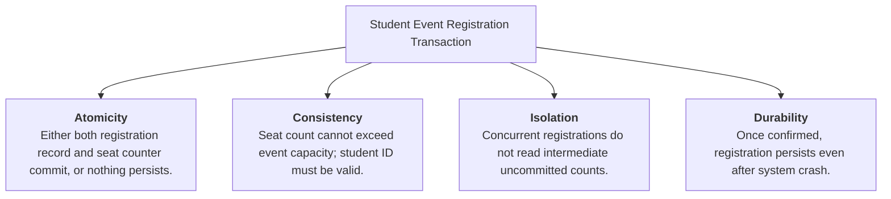
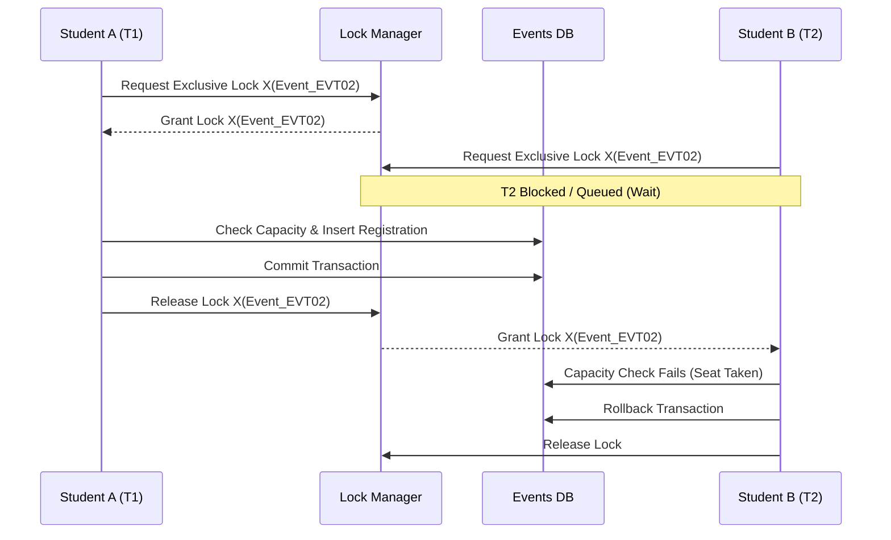

# TRANSACTION MANAGEMENT AND CONCURRENCY CONTROL SPECIFICATION
## College Event Management and Participation Analysis System

---

**Course Code & Name:** 25ITT31 – Database Management Systems (Unit 4)  
**Department:** Information Technology  
**Institution:** Velalar College of Engineering and Technology, Erode – 12  
**Activity:** Project-Based Assessment (Scenario 1)  

---

## 1. Transaction Concepts & ACID Properties

In the **College Event Management System**, student registration is a high-contention transactional operation. When multiple students simultaneously attempt to book the last remaining seat in a workshop, transactional integrity must be preserved.



### The Student Registration Transaction Unit:
```sql
START TRANSACTION;
-- Step 1: Lock the event record for update
SELECT capacity, registered_count FROM events WHERE event_id = 'EVT-02' FOR UPDATE;

-- Step 2: Verify business invariants
-- If registered_count >= capacity, ROLLBACK;

-- Step 3: Insert registration record
INSERT INTO registrations (registration_id, student_id, event_id, status)
VALUES ('REG-099', '25IT001', 'EVT-02', 'CONFIRMED');

-- Step 4: Increment event registration counter
UPDATE events SET registered_count = registered_count + 1 WHERE event_id = 'EVT-02';

COMMIT;
```

---

## 2. Concurrency Control Protocols

### 2.1 The Overbooking Race Condition (Lost Update)
Without proper concurrency control:
1. Transaction $T_1$ (Student A) reads remaining seats = 1.
2. Transaction $T_2$ (Student B) reads remaining seats = 1.
3. $T_1$ writes registration and sets remaining seats = 0.
4. $T_2$ writes registration and sets remaining seats = 0.
- **Result:** Capacity is breached by 1 student, violating the fundamental requirement (FR-03).

### 2.2 Two-Phase Locking Protocol (2PL)
To ensure **Conflict Serializability**, the system utilizes Strict 2-Phase Locking (Strict 2PL):
1. **Growing Phase:** Transaction acquires Shared ($S$) or Exclusive ($X$) locks as required. No locks can be released during this phase.
2. **Shrinking Phase:** In **Strict 2PL**, all exclusive locks held by a transaction are held until the transaction **commits or aborts**. This completely prevents cascading aborts (cascadeless schedules).



---

## 3. Deadlock Handling Mechanisms

Deadlock occurs when two or more transactions are in a simultaneous circular wait, each holding a lock that the other needs.

### 3.1 Deadlock Prevention Protocols (Timestamp-Based)
Each transaction $T_i$ is assigned a monotonic timestamp $TS(T_i)$ when it enters the system:
1. **Wait-Die Scheme (Non-preemptive):**
   - If older transaction $T_i$ requests a lock held by younger transaction $T_j$ ($TS(T_i) < TS(T_j)$), $T_i$ is allowed to **wait**.
   - If younger transaction $T_i$ requests a lock held by older transaction $T_j$ ($TS(T_i) > TS(T_j)$), $T_i$ is killed and rolled back (**dies**).
2. **Wound-Wait Scheme (Preemptive):**
   - If older transaction $T_i$ requests a lock held by younger $T_j$, $T_i$ preempts (**wounds**) $T_j$, forcing $T_j$ to abort and release the lock.
   - If younger $T_i$ requests a lock held by older $T_j$, $T_i$ is allowed to wait.

### 3.2 Deadlock Detection via Wait-For Graph (WFG)
The system periodically inspects the dynamic directed graph $G = (V, E)$:
- **Vertices ($V$):** Active transactions $\{T_1, T_2, \dots, T_k\}$.
- **Edges ($E$):** Directed edge $T_i \rightarrow T_j$ indicates that $T_i$ is waiting for a lock currently held by $T_j$.
- **Detection Algorithm:** Cycle detection using Depth-First Search (DFS). If a cycle exists ($T_1 \rightarrow T_2 \rightarrow T_3 \rightarrow T_1$), a deadlock is present.
- **Recovery Strategy:**
  1. **Victim Selection:** Abort the transaction with the minimum cost (least number of statements executed and youngest timestamp).
  2. **Rollback:** Perform partial rollback to the nearest safe savepoint, or full transaction abort.
  3. **Starvation Prevention:** Increment priority/age of victim transaction so it is not repeatedly selected for abortion.

---

## 4. Log-Based Recovery and Checkpointing

The database management system guarantees durability using Write-Ahead Logging (WAL) and fuzzy checkpointing:
- **Write-Ahead Logging (WAL):** A log record containing `[Transaction_ID, Data_Item, Old_Value, New_Value]` is flushed to non-volatile disk before the modified database buffer page is written to disk.
- **Checkpointing:** At regular intervals ($T_{\text{checkpoint}}$), all dirty memory pages are synchronized to disk, reducing crash recovery scanning time.
- **Recovery Operations:**
  - **REDO Phase:** Reapply updates of all committed transactions since the last checkpoint.
  - **UNDO Phase:** Reverse all uncommitted operations that were active at the moment of failure.
